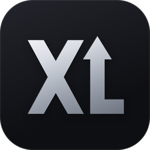
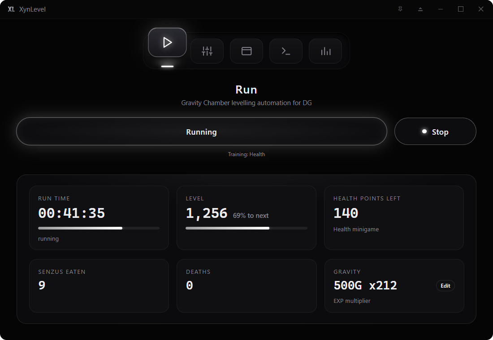
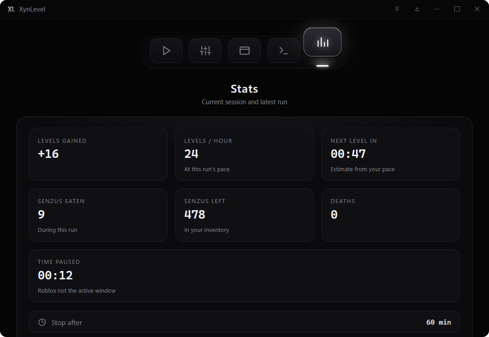
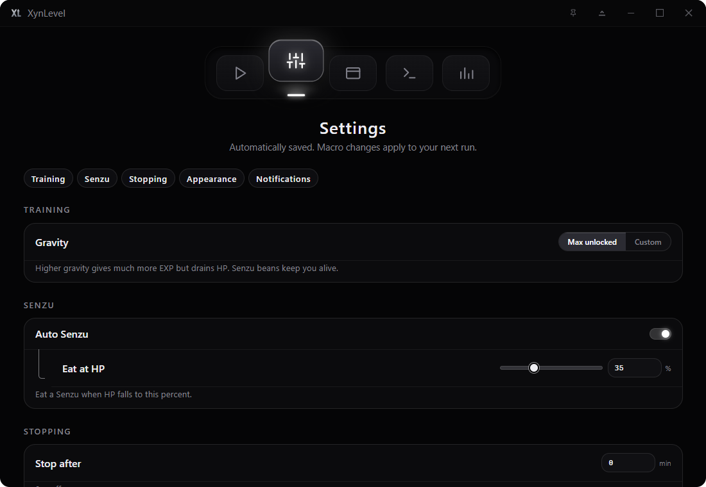

<p align="center">
  
</p>

<h1 align="center">XynLevel</h1>

<p align="center">
  Levels your <b>Dragon Generations</b> (DG, formerly Dragon Ball Online Generations / DBOG) character in the Gravity Chamber while you're away.<br>
  Free, open source, Windows 10/11.
</p>

<p align="center">
  <a href="https://github.com/lowkxyn/xynlevel/releases/latest"><b>Download the latest release</b></a>
</p>

https://github.com/user-attachments/assets/cd2ed2d1-334d-4f0c-bed8-a4577b30f484

---

## What it does

You stand in the Gravity Chamber, press **F6**, and XynLevel trains for you. Since the Halloween 2026 update, the
Chamber's EXP comes from its training minigames, multiplied by the gravity you train at (at 500G it's about x212),
while that gravity drains your HP. XynLevel plays that loop:

- **Sets your gravity.** By default the highest gravity your account has unlocked, or a value you choose.
- **Plays the Health training minigame.** It presses F whenever the marker is inside the gold zone.
- **Eats Senzu beans.** When HP falls to the level you set, it stops training, eats the bean in item slot 1 and
  carries on. It keeps a bean loaded by re-equipping one from your inventory while HP is full.
- **Respawns** after a gravity death and walks back into the gravity field.
- **Stops when you want:** after a run time, at a level, when your Senzu beans run out, or when the game sends
  you out of the Chamber (its daily training limit). Then it can close itself or shut down the PC.
- **Leaves you safe:** at the end of a run it puts gravity back to 1G, so an idle character doesn't drain.
- **Sets the Roblox window up for you:** fullscreen on a 1080p screen, a centred 1920 x 1080 window on a
  bigger one. It also closes Roblox's Performance Stats bar (Ctrl+F7) if it covers the level.
- **Shows live stats:** run time, level and XP, Senzus eaten and left, deaths, gravity and EXP multiplier,
  levels per hour and time to the next level.
- **Optional Discord reports** through your own webhook.

<p align="center">
  
  
</p>

## Install

1. Download **`XynLevel_1.0.1_setup.exe`** from the
   [latest release](https://github.com/lowkxyn/xynlevel/releases/latest).
2. Run it and click **Install**. It installs for your Windows account only (to
   `%LOCALAPPDATA%\XynLevel`), so it doesn't need admin rights.

**"Windows protected your PC"?** XynLevel isn't code-signed (signing certificates cost money each year),
so Windows SmartScreen doesn't recognise it yet. Click **More info**, then **Run anyway**. The full source
is in this repo, and every release is built from it. If your antivirus flags it, that's usually because
the bot is a packaged Python program that sends key presses. You can build it yourself from source
(see below) if you'd rather.

## Quick start

1. Open Roblox, join DG and go into the **Gravity Chamber** (the chamber itself, not the bot room). Have
   Senzu beans in your inventory; XynLevel loads them into item slot 1 itself.
2. Open XynLevel and look through **Settings**. The defaults work for most people.
3. Click into Roblox so it's the active window, then press **F6**. Press **F6** again to stop.

Keep Roblox as the active window while it runs. If you click away, the run pauses and carries on when
you come back. F6 only starts a run while Roblox is the active window, so pressing it in another app
won't start anything. It stops a run from anywhere.

## Requirements

| | |
| --- | --- |
| Windows | 10 or 11 (64-bit) |
| Display | 1920 x 1080 or larger |
| Roblox | The normal Roblox desktop app |
| Language pack | The English Windows OCR pack, for level and XP readings. Without it the run still works, the level tiles just stay empty. |

The bot reads the screen at exactly 1920 x 1080. You don't have to set that up yourself: every run puts
Roblox in fullscreen on a 1080p display, or in a centred 1920 x 1080 window on a bigger one. The
**Window** page shows the current size and has a **Set window** button if you want to do it before a run.

## Settings

Everything saves as you change it and applies to your next run.

<p align="center"></p>

### Training

| Setting | Default | What it does |
| --- | --- | --- |
| Gravity | Max unlocked | **Max unlocked** uses the highest gravity your account can set (it goes up with story quests). **Custom** uses the value you type, 1 to 500, capped at your maximum. |

Higher gravity gives far more EXP but drains HP faster. On a level 1,250 character nothing changes up to about
360G, then 400G drains about 100 HP/s for x8 EXP and 500G about 520 HP/s for x212.

### Senzu

| Setting | Default | What it does |
| --- | --- | --- |
| Auto Senzu | On | Eats a Senzu bean when HP falls to the threshold, and keeps one loaded in item slot 1. |
| Eat at HP | 35% | The HP level that triggers a bean. |

Item slot 1 is the only item slot XynLevel ever presses. Your other item slots are left alone.

### Stopping

| Setting | Default | What it does |
| --- | --- | --- |
| Stop after | 0 (off) | Ends the run after this many minutes. |
| Stop at level | 0 (off) | Ends the run when you reach this level. |
| After the run | Do nothing | Or **Close XynLevel**, or **Shut down PC**, after a run that reached its stop time or level. There's a 30-second countdown you can cancel. Windows shutdown is never forced. |

A run also ends if your Senzu beans run out (with Auto Senzu on) or the game puts you outside the Chamber.

### Appearance and notifications

Themes (Steel, Glass, Daylight, Follow Windows), accent colours, keycap or dial navigation, reduce
motion, and a pin button in the title bar to keep XynLevel on top. **Desktop notifications** shows a
Windows pop-up when a run ends, and **Sound when the run ends** plays a sound at the stop time.

## Discord reports (optional)

In **Settings > Notifications**, paste a Discord webhook URL and click **Save**. XynLevel can then post:

- when a run finishes, is stopped, or needs attention (for example Roblox disconnected)
- progress updates every 5 to 60 minutes while it runs, if you turn them on

Reports only contain run counters: run time, level, levels gained, Senzus eaten and deaths. The webhook
is encrypted for your Windows account, never shown again, and only ever sent to `discord.com`. **Send
test** checks it works, and **Remove** deletes it.

## Stats

The **Run** page shows run time, level and XP, Health training points left, Senzus eaten, deaths, and the
gravity with its EXP multiplier. The **Stats** page adds levels gained, levels per hour, time to the next level,
Senzus left and time paused.

## Privacy and safety

- **Everything stays on your PC.** XynLevel has no account, no telemetry and no update server. The only
  thing it ever sends anywhere is a Discord webhook report, if you set one up.
- **It works like a person at the keyboard.** It reads the screen and presses keys and clicks. It doesn't
  read or change Roblox's memory or files, and it doesn't inject anything into the game.
- **Bug reports are redacted.** Tools > Bug report shows you exactly what will be saved before it saves
  a ZIP: settings, the game-area size, the run result and events with paths, emails, IPs and links
  removed. No screenshots.
- **The app's local connection is locked down.** The window talks to the bot over a localhost port that
  needs a fresh random token each launch and rejects web pages.
- **Use it at your own risk.** Automation can be against a game's rules. You're responsible for how you
  use it.

Settings, logs and saved bug reports live in `%LOCALAPPDATA%\com.xynlevel.app` (**Tools > Open app
data** opens it).

## Troubleshooting

| Problem | Fix |
| --- | --- |
| F6 does nothing | Click into Roblox first. F6 only starts a run while Roblox is the active window. |
| "Roblox not found" | Open the Roblox desktop app and join the game before starting. |
| "Not in the Gravity Chamber" | Go into the Chamber first. If its door says "You have trained enough, get some rest", the game's daily training limit is used up: try again after the wait it shows. |
| "No Senzu beans left" | Get more, or turn Auto Senzu off and use a gravity you can survive. |
| Window size is wrong | Click **Set window** on the Window page, or just start a run. On a display smaller than 1920 x 1080 it can't work. |
| It pauses | Roblox lost focus. Click back into Roblox and it carries on. |
| Level shows "--" | Install the English Windows OCR language pack (Settings > Time & language > Language). |
| Keys seem stuck after a crash | Tap F, H and Ctrl. XynLevel releases them when it closes, even if the bot stops responding. |

## Reporting a bug

Open an [issue](https://github.com/lowkxyn/xynlevel/issues) and attach a bug report from **Tools > Bug
report**. Say what you expected, what happened, your race and level, and your display size.

## Uninstall

Windows Settings > Apps > Installed apps > **XynLevel** > Uninstall. To remove your settings and logs
too, delete `%LOCALAPPDATA%\com.xynlevel.app`.

## Build from source

Needs Python 3.11+, [Bun](https://bun.sh), Rust (MSVC) and 7-Zip.

```powershell
py -m pip install -r app/python/requirements.txt
cd app
bun install
powershell -NoProfile -ExecutionPolicy Bypass -File scripts/build_release.ps1
powershell -NoProfile -ExecutionPolicy Bypass -File scripts/build_custom_installer.ps1
```

The setup file lands in `app/dist/`. The release script also scans everything it ships, including inside
the installer, and refuses the build if it finds your Windows username, computer name, or anything you
list in the `XYNLEVEL_PRIVATE_WORDS` environment variable (comma-separated).

Tests: `py -m pytest tests app/tests` and `cd app && bun test src/`. Most bot tests replay real game
screenshots, which aren't published, so those test files are skipped on a fresh clone.

### Layout

| Path | What's there |
| --- | --- |
| `gc_train.py` | The training loop: gravity, the Health minigame, Senzu, respawn |
| `gc_*.py`, `window.py` | Screen reading, input helpers, window setup, and the older bot-room code |
| `assets/` | Digit and menu templates the bot matches against |
| `app/src/` | The app's UI (plain JavaScript) |
| `app/python/` | The local bridge between the UI and the bot |
| `app/src-tauri/` | The Tauri (Rust) app window |
| `app/installer/` | The themed installer |
| `tests/`, `app/tests/` | Tests |

## Licence

[MIT](LICENSE). Made by Xyn.
